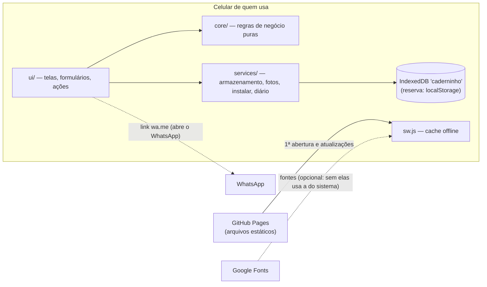
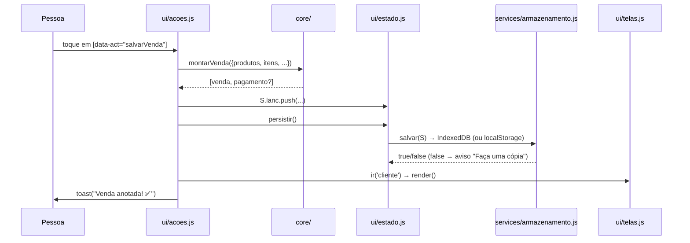

# Arquitetura

## 1. Visão geral

O Caderninho dos Doces é um **PWA estático, local-first**: um site de arquivos fixos que roda inteiro no
navegador do celular, guarda os dados no próprio aparelho e funciona sem internet. **Não existe servidor de
aplicação, banco de dados central nem API própria.** Isso é uma decisão de produto, não uma lacuna: as contas
de quem vende são privadas, o app não pode depender de sinal de internet, e não há custo de hospedagem.

Por isso a arquitetura é **um monólito modular no front-end**, em camadas, sem build e sem dependências.
Microsserviços, frameworks ou um backend seriam complexidade sem benefício para este produto.



## 2. Camadas e responsabilidades

Regra de dependência: **`ui` → `core` e `services`; `services` → `config`; `core` não depende de nada.**
`core/` não toca em `document`, `window`, `localStorage` nem `Date.now()` implícito em regra que precise de
teste — o que precisa de "agora" ou de "novo id" recebe isso por parâmetro.

| Módulo | Camada | Responsabilidade |
|---|---|---|
| `js/config.js` | config | Configuração central congelada: nomes de armazenamento (contrato), versão da cópia, dias para lembrar cópia, tamanho/qualidade de foto, formas de pagamento, DDI, limites de busca, tempo dos avisos, diário |
| `js/core/formato.js` | core | `esc`, `brl`, `r2`, `parseMoney`, `moneyStr`, `hoje`, `fmtData`, `uid`, `inicial`, `filtrarPorNome` |
| `js/core/contas.js` | core | `saldo` (vendas − pagamentos, sempre calculado), `resumo` (mês ou tudo), `devedores`, `historico`, `faltaCusto`, `produtoJaVendido`, `precisaCopia` |
| `js/core/lancamentos.js` | core | `totalCarrinho`, `montarVenda` (congela nome/preço/custo do dia; cria o pagamento "Na hora"), `montarPagamento` |
| `js/core/copia.js` | core | `montarCopia` e `lerCopia` (valida; nunca lança exceção) — contrato da cópia de segurança |
| `js/services/armazenamento.js` | services | `carregar` / `salvar` no IndexedDB, com localStorage como reserva; `pedirArmazenamentoPersistente` |
| `js/services/fotos.js` | services | `comprimir` (JPEG, lado maior 480px), `lerTexto` (arquivo da cópia) |
| `js/services/instalar.js` | services | Botão "Instalar" (`beforeinstallprompt`), detecção de iPhone/instalado, registro do service worker |
| `js/services/log.js` | services | Diário técnico: console + últimos 50 avisos/erros em `localStorage['caderninho-log']`; captura erros globais; `caderninhoDiagnostico()` no console |
| `js/ui/estado.js` | ui | Estado em memória: `S` (as contas) e `ui` (tela atual, período, busca, venda em andamento); `persistir()` |
| `js/ui/janelas.js` | ui | Janela de baixo (`abrir`/`fechar`), avisos (`toast`), confirmação (`perguntar`) |
| `js/ui/telas.js` | ui | `vResumo`, `vClientes`, `vCliente`, `vVender`, `vProdutos`; `render()` e `ir()` |
| `js/ui/formularios.js` | ui | Formulários de cliente, produto, pagamento e configurações; `rascunho` (foto/forma em edição) |
| `js/ui/acoes.js` | ui | **Único** listener de cliques (`data-act`/`data-id`/`data-v`) → tabela `ACOES`; listeners de digitação e de arquivo |
| `js/main.js` | entrada | Liga monitoramento, janelas, ações e instalação; carrega as contas; desenha a 1ª tela; registra o `sw.js` |
| `css/estilo.css` | apresentação | Tema claro/escuro por variáveis CSS, botões ≥ 48–58px, letra 18px |
| `sw.js` | infraestrutura | Cache "mostra o guardado, atualiza em segundo plano" (stale-while-revalidate) |

## 3. Fluxos

### Toque num botão



Qualquer exceção dentro de uma ação é capturada em `iniciarAcoes()`: vai para o diário (`log.erro`) e a
pessoa vê "Algo deu errado. Tente de novo." — nunca uma tela travada.

### Abertura do app

1. `index.html` carrega `css/estilo.css` e `js/main.js` (módulo).
2. `main.js` liga os listeners, pede armazenamento persistente, `carregar()` → `aplicarDados()` → `render()`.
3. `registrarOffline()` registra o `sw.js`. A partir daí as aberturas vêm do cache; a versão nova é baixada
   em segundo plano e aparece na abertura seguinte.

### Atualização de versão (service worker)

Trocar `VERSAO` em `sw.js` faz o navegador instalar o novo SW, que baixa **todos** os `ARQUIVOS` num cache
novo e apaga os antigos. `npm run verificar` garante que todo arquivo de `app/` está na lista.

## 4. Dados (contrato — não quebrar)

Local: IndexedDB `caderninho` (versão 1) → store `kv` → chave `caderninho-v1`;
reserva: `localStorage['caderninho-v1']`. Diário técnico separado em `localStorage['caderninho-log']`.

```js
{ produtos: [{id, nome, preco, custo, foto /* dataURL jpeg 480px */, ativo}],
  clientes: [{id, nome, tel}],
  lanc: [ {id, tipo:'venda', clienteId, itens:[{produtoId, nome, qtd, preco, custo}], valor, custo, data:'AAAA-MM-DD', criado},
          {id, tipo:'pag',   clienteId, valor, forma /* Pix|Dinheiro|Cartão|Na hora */, data, criado} ],
  ultimoBackup: timestamp|null }
```

- Saldo nunca é guardado: é sempre `vendas − pagamentos`.
- A venda guarda nome/preço/custo **daquele dia**.
- Dados antigos podem não ter `custo`, `foto` ou `ultimoBackup`: o código trata ausência como 0/null.
- Cópia de segurança: `{app:'caderninho', versao:1, em, dados:{produtos, clientes, lanc}}`.
  `lerCopia` aceita qualquer objeto com as três listas (compatível com cópias antigas).

## 5. Dependências

| Tipo | Item | Necessário para |
|---|---|---|
| Em produção | **nenhuma biblioteca** | — |
| Serviço externo | GitHub Pages | Hospedar e atualizar o app |
| Serviço externo | Google Fonts | Fontes Baloo 2 / Nunito Sans (sem elas, usa fontes do sistema; o SW guarda as fontes para uso offline) |
| Serviço externo | WhatsApp (`wa.me`) | Só o link "Cobrar no WhatsApp"; nada é enviado pelo app |
| Desenvolvimento | Node.js ≥ 22 | Servidor local, verificador, testes de unidade |
| Desenvolvimento | `playwright` 1.63.0 (fixo no `package-lock.json`) | Teste de ponta a ponta |
| CI | GitHub Actions | `testes.yml` (todo envio) e `pages.yml` (publicar) |

## 6. Ambientes

| Ambiente | Como roda | Dados |
|---|---|---|
| Desenvolvimento | `npm start` → http://127.0.0.1:8000, `Cache-Control: no-cache` | IndexedDB do navegador do computador (origem `127.0.0.1:8000`, separada da produção) |
| Testes | `npm run test:e2e` sobe o servidor numa porta livre e usa perfis de navegador descartáveis | Criados e jogados fora a cada teste |
| Produção | GitHub Pages, publicado pelo `pages.yml` só a partir do ramo principal | No celular de cada pessoa |

## 7. Como crescer sem perder a simplicidade

- **Nova tela:** função `vNome()` em `ui/telas.js` + entrada em `TELAS`; ações novas em `ACOES` (`ui/acoes.js`).
- **Nova regra de conta:** função pura em `core/` + teste em `tests/unit/`.
- **Novo campo nos dados:** opcional e com valor padrão na leitura; nunca renomear campos existentes.
- **Mudança de formato inevitável:** subir `COPIA_VERSAO`, manter `lerCopia` lendo a versão anterior, e
  escrever a migração na carga (`aplicarDados`).
- **Sincronização em nuvem (se um dia):** entra como um novo `services/` sem tocar em `core/`; os dados no
  aparelho continuam sendo a fonte principal. Avaliar privacidade e custo antes (veja MIGRATION.md, ramos pendentes).
